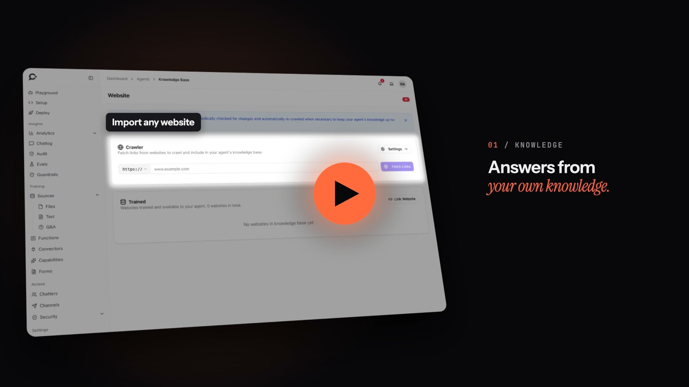

<p align="center">
  
</p>

<p align="center">
  <a href="https://chatvia.ai/docs/"><strong>Documentation</strong></a> ·
  <a href="https://chatvia.ai/docs/guide/installation">Install</a> ·
  <a href="https://chatvia.ai/features">Features</a> ·
  <a href="https://github.com/chatvia/shakomako">Chat widget</a> ·
  <a href="https://chatvia.ai/license">License</a>
</p>

<p align="center">
  <a href="https://github.com/chatvia/chatvia/actions/workflows/tests.yml"></a>
  <a href="https://github.com/chatvia/chatvia/actions/workflows/php-quality.yml"></a>
  <a href="https://github.com/chatvia/chatvia/actions/workflows/typescript-quality.yml"></a>
  <a href="https://github.com/chatvia/chatvia/actions/workflows/security.yml"></a>
  <a href="https://github.com/chatvia/chatvia/actions/workflows/scripts.yml"></a>
  <br>
  <a href="https://github.com/chatvia/chatvia/actions/workflows/docker.yml"></a>
  <a href="https://github.com/chatvia/chatvia/actions/workflows/postgres-image.yml"></a>
  <a href="LICENSE"></a>
</p>

<p align="center">
  <a href="https://www.php.net"></a>
  <a href="https://laravel.com"></a>
  <a href="https://filamentphp.com"></a>
  <a href="https://redis.io"></a>
  <br>
  <a href="https://www.postgresql.org"></a>
  <a href="https://github.com/pgvector/pgvector"></a>
  <a href="https://github.com/timescale/pg_textsearch"></a>
  <a href="https://github.com/pgpartman/pg_partman"></a>
  <br>
  <a href="https://inertiajs.com"></a>
  <a href="https://vuejs.org"></a>
  <a href="https://www.typescriptlang.org"></a>
  <a href="https://tailwindcss.com"></a>
  <a href="https://vite.dev"></a>
  <a href="https://nodejs.org"></a>
</p>

<p align="center">
  <a href="https://chatvia.ai/#hero-video"></a>
  <br>
  <sub><a href="https://chatvia.ai/#hero-video">Watch how ChatVia.ai works</a></sub>
</p>

---

## What is ChatVia.ai?

ChatVia.ai is a free, self-hosted platform for AI chat agents that answer from
your own knowledge. It runs on your server, so your files, chats and customer
details stay with you.

A team creates agents, gives them knowledge (files, web pages, text, Q&A
pairs, audio and video), connects them to tools, and puts them in front of
people: on a hosted chat page, in a widget on any website, in a command bar,
in six messaging apps, or through a REST API. Answers come from
retrieval-augmented generation (RAG) with hybrid search (vectors and keywords)
inside PostgreSQL. Every agent can use a different model, including
open-weight models.

## Highlights

- **Your data, your server.** Install with one command, with Docker or directly on Ubuntu. Nothing leaves your infrastructure except the calls to the AI provider you choose.
- **Any model.** Frontier models such as Claude, GPT and Gemini, or open-weight models such as Llama and Qwen. Pick a model per agent.
- **Knowledge that stays fresh.** Files, websites, plain text, Q&A pairs, audio and video become searchable chunks. Hybrid search and reranking keep answers grounded in your sources.
- **Tools and connectors.** Connect any MCP server, use the ready-made connectors, or write your own functions. Risky tool calls can wait for a person's approval, and every call is logged.
- **Every channel.** Hosted chat, website widget, command bar, WhatsApp, Messenger, Instagram, Slack, Microsoft Teams and Telegram. One agent, one knowledge base, every channel.
- **Built for teams.** Workspaces, teams and permissions, human handoff with a live inbox, chat logs, analytics, forms and lead capture, evals and an audit log.
- **Safe by default.** Guardrails are on from the first message, with content rules, per-visitor limits and blocking.
- **Open to your software.** A REST API with bearer tokens covers agents, sources, conversations, chatters, forms, evals and more.

## Quick start

Install on Linux or macOS with one command:

```bash
curl -fsSL https://chatvia.ai/install.sh | bash
```

The installer asks a few questions, installs everything and tells you where
to sign in. Read the [installation guide](https://chatvia.ai/docs/guide/installation)
for the details of each path:

| Path | Best for |
| --- | --- |
| [Docker](https://chatvia.ai/docs/guide/installation/docker) | A server or your own computer. Everything runs in containers. |
| [Ubuntu](https://chatvia.ai/docs/guide/installation/ubuntu) | A fresh Ubuntu server, without Docker. |
| [From source](https://chatvia.ai/docs/guide/installation/from-source) | Working on the code, or a custom setup. |

Then follow the [quick start](https://chatvia.ai/docs/guide/quick-start) to
create your first agent.

## Documentation

The full guide is at **[chatvia.ai/docs](https://chatvia.ai/docs/)**.

| Topic | Start here |
| --- | --- |
| Getting started | [Introduction](https://chatvia.ai/docs/guide/introduction) · [Quick start](https://chatvia.ai/docs/guide/quick-start) · [Core concepts](https://chatvia.ai/docs/guide/core-concepts) · [How it works](https://chatvia.ai/docs/guide/how-it-works) |
| Installation | [Install](https://chatvia.ai/docs/guide/installation/docker) · [Manage](https://chatvia.ai/docs/guide/installation/manage) · [What the install sends out](https://chatvia.ai/docs/guide/installation/outside-calls) |
| Agents | [Create an agent](https://chatvia.ai/docs/guide/agents/create) · [Persona](https://chatvia.ai/docs/guide/agents/persona) · [Models](https://chatvia.ai/docs/guide/agents/models) · [Playground](https://chatvia.ai/docs/guide/agents/playground) |
| Knowledge | [Sources](https://chatvia.ai/docs/guide/sources/overview) · [Search](https://chatvia.ai/docs/guide/how-it-works/search) |
| Tools | [MCP connectors](https://chatvia.ai/docs/guide/tools/connectors) · [Functions](https://chatvia.ai/docs/guide/tools/functions) |
| Where people chat | [Widget](https://chatvia.ai/docs/embed/widget) · [Hosted chat](https://chatvia.ai/docs/embed/hosted-chat) · [Command bar](https://chatvia.ai/docs/embed/command-bar) · [Messaging channels](https://chatvia.ai/docs/guide/channels/) |
| Conversations | [Chat logs](https://chatvia.ai/docs/guide/chat/logs) · [Human handoff](https://chatvia.ai/docs/guide/chat/handoff) · [Leads](https://chatvia.ai/docs/guide/chat/leads) · [Analytics](https://chatvia.ai/docs/guide/chat/analytics) |
| Workspace and account | [Teams](https://chatvia.ai/docs/guide/account/teams) · [API keys](https://chatvia.ai/docs/guide/account/api-keys) · [Message limits](https://chatvia.ai/docs/guide/account/message-limits) · [Licenses](https://chatvia.ai/docs/guide/account/licenses) |
| Developers | [REST API](https://chatvia.ai/docs/guide/api/) · [Admin panel](https://chatvia.ai/docs/guide/admin-panel/) |

To work on the code itself, start with [ARCHITECTURE.md](ARCHITECTURE.md)
and [CONTRIBUTING.md](CONTRIBUTING.md).

## Contributing

Bug reports and feature requests are welcome as
[issues](https://github.com/chatvia/chatvia/issues/new/choose). We do not
accept pull requests: a maintainer makes every change. See
[CONTRIBUTING.md](CONTRIBUTING.md) for how the project is built and tested,
and our [Code of Conduct](CODE_OF_CONDUCT.md) for how we work together.

Changes are listed in [CHANGELOG.md](CHANGELOG.md).

## Security

Found a security problem? Please report it privately. [SECURITY.md](SECURITY.md)
explains how.

## License

ChatVia.ai is free and source-available under the
[ChatVia.ai License](LICENSE), for individuals and companies alike. You may
use, change, copy and run it.

The license has a few conditions: the "Powered by ChatVia.ai" credit stays
under every chat, some features need a license key, and running ChatVia.ai
as a hosted service for others needs a SaaS key. Without a key an install
holds one workspace and has no API, no voice conversations, no live chat,
no capabilities (charts, calendar booking, forms and leads, image, audio and
video generation), no custom domains, the default Splitting settings and no
sentiment, tone, topics or sources analytics (condition 4 of the license).
License keys, and what each one unlocks, are explained at
**[chatvia.ai/license](https://chatvia.ai/license)**.
